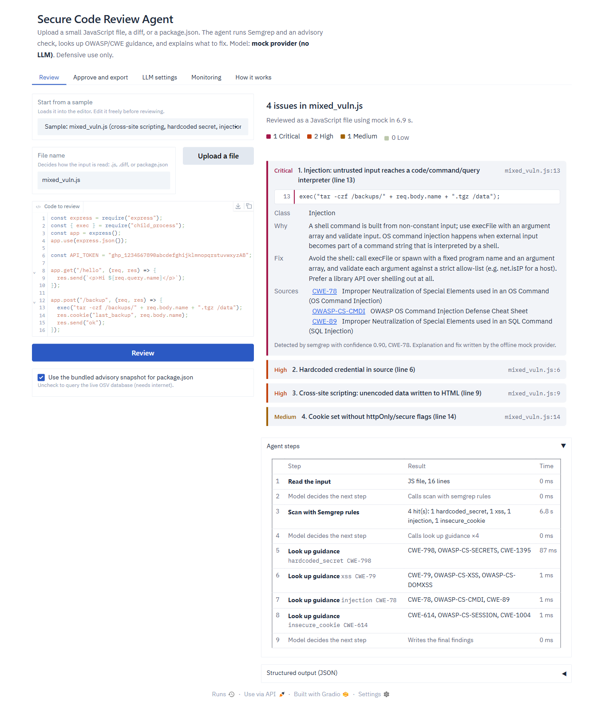

# Secure Code Review Agent

An AI agent that reviews small JavaScript/Node files, diffs, and `package.json` manifests for common
web-app vulnerabilities. It runs real static-analysis and dependency tools, grounds its explanations
in OWASP/CWE guidance, and returns structured, evidence-backed findings. A person approves findings
before any PR comment or patch draft is produced.

Capstone project: Applied AI Agents for Cybersecurity Operations, Fall 2026 (brief 9B).
Defensive use only. See [`docs/03-safety-boundaries.md`](docs/03-safety-boundaries.md).



## Before you start

| Need | Required? | How to get it |
|------|-----------|---------------|
| **Python 3.10 or newer** (3.12 tested) | Yes, unless you use Docker | Windows: `winget install -e --id Python.Python.3.12`, or the installer from <https://www.python.org/downloads/> with **"Add python.exe to PATH"** ticked. macOS: `brew install python@3.12`. Linux: your package manager (`python3`, `python3-venv`). |
| Internet access during install | Yes | `pip` downloads the dependencies (Gradio, Semgrep, scikit-learn, ...). After that the app runs offline. |
| Docker Desktop / Docker Engine | Only for the Docker option | <https://docs.docker.com/get-docker/>. It must be running before `docker compose up`. |
| An LLM (Ollama, LM Studio, or an API key) | No | The built-in mock model works without one. See [`docs/LLM_SETUP.md`](docs/LLM_SETUP.md). |

**Node.js is not needed.** The agent never runs the JavaScript it reviews, and Semgrep, the scanner,
is installed by `pip` from `requirements.txt`.

Check Python with `python --version` in a new terminal. On Windows, if that opens the Microsoft Store
or says "Python was not found", Python isn't installed yet (or isn't on PATH). Install it as above and
open a new terminal.

## Quick start (Windows)

```powershell
python -m venv .venv
.venv\Scripts\python -m pip install -r requirements.txt
.venv\Scripts\python -m pip install -e . --no-deps
.venv\Scripts\python -m scra.app
```

The second install registers the `scra` package itself, which `python -m scra.app` and
`python -m scra.cli` need. `requirements.txt` only installs the dependencies.

Open <http://127.0.0.1:7860>, keep **Sample: mixed_vuln.js**, select **Review**.

macOS / Linux: `python3 -m venv .venv && .venv/bin/pip install -r requirements.txt && .venv/bin/pip install -e . --no-deps && .venv/bin/python app.py`.
Docker: `docker compose up --build`. Details: [`docs/DEPLOY.md`](docs/DEPLOY.md).

The app starts with an offline **mock** model, so it works with no setup. To use a real LLM, local
(Ollama, LM Studio) or hosted (Groq, Gemini, OpenRouter, OpenAI), see
[`docs/LLM_SETUP.md`](docs/LLM_SETUP.md).

**New here?** [`docs/TRY_IT.md`](docs/TRY_IT.md) walks through every feature and what you should see.

## How it works

```
upload → parse_input → LLM agent loop ─┬─ run_semgrep         (custom rules, 5 code classes)
                                       ├─ check_dependencies  (OSV, offline snapshot fallback)
                                       └─ retrieve_guidance   (RAG over OWASP/CWE)
       → grounding guard (schema + must match tool evidence) → findings + live trace
       → human approval → PR comments / patch draft (never posted or applied)
```

- **Tools detect, the LLM explains.** The model chooses which tools to call and writes the
  explanation and fix. Every finding must match a tool hit; line numbers, snippets and tool names
  always come from the tool. Tool hits the model leaves out are restored, so a weak or misbehaving
  model can't hide an issue.
- **Six vulnerability classes:** XSS, injection (SQL, OS command, eval), insecure cookies, missing
  input validation, hardcoded secrets, vulnerable dependencies.
- **Each finding:** `finding`, `vuln_class`, `cwe`, `evidence` (file, line, snippet), `severity`,
  `explanation`, `fix`, `confidence`, `sources`, `tool`, `explained_by`.

Architecture: [`docs/02-architecture.md`](docs/02-architecture.md).

## The app

| Tab | What it does |
|-----|--------------|
| **Review** | Pick a sample, upload, or type code; findings with evidence, fix and sources; the agent's steps live; JSON download |
| **Approve and export** | Approve or reject each finding; draft PR comments and patch diffs for approved findings only |
| **LLM settings** | Choose a provider, fetch its models, test the connection (server, model, tool calling), set time limits |
| **Monitoring** | Review count, latency, tool failures, findings by class, reviewer decisions, recent runs |
| **How it works** | Pipeline, where each part of a finding comes from, safety boundaries |

## Command line

```powershell
.venv\Scripts\python -m scra.cli review data\samples\mixed_vuln.js
.venv\Scripts\python -m scra.cli review data\samples\xss_added.diff
.venv\Scripts\python -m scra.cli review data\samples\package_vuln.json --offline --json
.venv\Scripts\python -m scra.cli stats      # summary of the logs
.venv\Scripts\python -m scra.cli ui         # same as python -m scra.app
```

Settings come from environment variables or a `.env` file (copy [`.env.example`](.env.example)).

## Tests and evaluation

```powershell
.venv\Scripts\python -m pytest                                   # 72 tests
.venv\Scripts\python eval\evaluate.py --mode tools               # detection, development set
.venv\Scripts\python eval\evaluate.py --mode tools --set heldout # detection, held-out set
.venv\Scripts\python eval\evaluate.py --demo                     # 10 end-to-end demo cases
.venv\Scripts\python eval\evaluate.py --all --out eval\results\week6.json
```

| Measure | Result |
|---------|--------|
| Detection, development set (21 inputs) | P = R = F1 = 1.00 (rules and data by the same author) |
| Detection, held-out set (13 inputs, written after rules froze) | P = 0.77, R = 0.77, F1 = 0.77 |
| End-to-end demo cases | 10 / 10 |
| Safety checks | 7 / 7 |
| Explanation rubric (automated checks) | 100 % of findings pass |

Full results, caveats, and what's still missing: [`eval/EVALUATION.md`](eval/EVALUATION.md).

## Repository layout

```
app.py              entry point (python app.py, Hugging Face Spaces)
src/scra/           agent, LLM providers, tools, approval step, Gradio app, CLI
rules/              custom Semgrep rules
data/samples/       labeled development samples       data/labels.json         ground truth
data/heldout/       held-out samples                  data/heldout_labels.json ground truth
data/demo/          UI scenarios (prompt injection, unsupported input, known gaps)
data/kb/            OWASP/CWE knowledge base          data/osv_snapshot.json   offline advisories
eval/               evaluation harness, demo cases, results, rubric
tests/              pytest suite
docs/               scope, architecture, safety, setup, deployment, demo script, report
Dockerfile, docker-compose.yml, .env.example
```