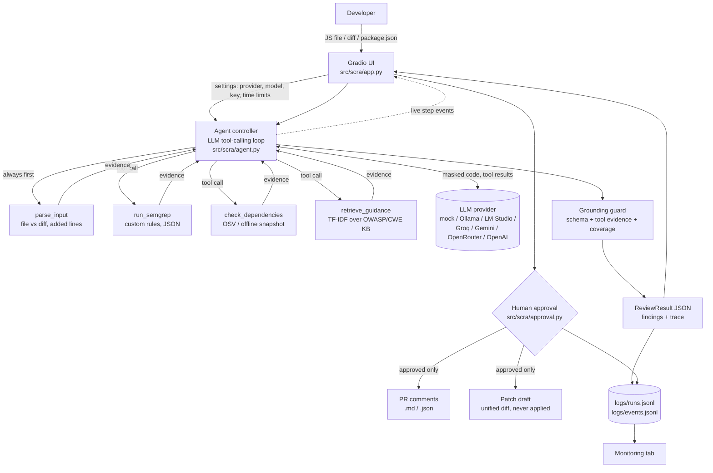

# Architecture

## Components

| Component | Choice | Why |
|-----------|--------|-----|
| UI | Gradio 6 Blocks, five tabs | Required by the SDLC guide |
| Agent | Plain Python tool-calling loop | Transparent, easy to trace and explain at demo |
| LLM | One `Provider` interface: mock, Ollama, any OpenAI-compatible API, with presets | Free local option, free hosted option, and a deterministic mock for tests and offline demos |
| Static analysis | Semgrep with custom rules in `rules/` | Reproducible offline, every rule is explainable |
| Dependency check | OSV.dev API, offline snapshot fallback | `npm audit` needs a lockfile + network |
| RAG | Curated OWASP/CWE knowledge base, TF-IDF retriever | Small corpus, deterministic, no GPU |
| Output contract | Pydantic models | Rejects malformed LLM output before it reaches the UI |
| Human approval | `ReviewSession` + `ApprovalRequired`, checked in the backend | Sensitive actions can't be triggered by skipping the UI |
| Patch drafts | Rule-based rewrites (mock) or LLM drafts from masked code, shown as diffs | Useful suggestion without ever modifying code |
| Logging | JSONL per run and per event | Tool calls, latency, errors, decisions; no code stored |
| Deployment | Dockerfile, Compose (optional Ollama service), Hugging Face Docker Space | Reproducible; `SCRA_HOSTED=1` locks down server URLs on public deployments |

## One review, step by step

1. **Input.** Size-checked (200 KB), decoded as UTF-8, classified by file name and content.
   Binary, empty, and unsupported files are rejected with a message. Nothing is executed.
2. **Loop.** The system prompt and the (secret-masked, line-numbered) input go to the model with
   three tool definitions. The model calls tools; results are appended to the conversation; the
   loop ends when the model replies with JSON findings, after 8 steps, or at the time limit.
   Each model call and tool call is emitted as an event so the UI shows progress live.
3. **Guarantees.** If the model never ran the detection tool, the agent runs it. If the detection
   tool failed, the result says the review is incomplete.
4. **Guard.** Each model finding is validated against the schema and matched to the closest
   unclaimed tool hit of the same class (±2 lines, or same package). Unmatched findings are dropped
   and counted. Evidence and tool name are copied from the hit; confidence may move at most ±0.15;
   text is filtered for attack payloads. Tool hits with no model finding get template text.
5. **Result.** Sorted by severity, logged as metadata, rendered, and kept in the browser session
   for the approval step.

## Data flow and trust

- **Detection comes from tools; the LLM explains, ranks, and writes fixes.** It can't add a finding
  without tool evidence, and it can't remove one.
- Uploaded code is untrusted data. The prompt says so, and instructions inside the code can't
  suppress findings (tested).
- What reaches a remote model: masked code (first 300 lines), tool results, retrieved KB text.
  What never does: secret values, API keys of other providers, logs.
